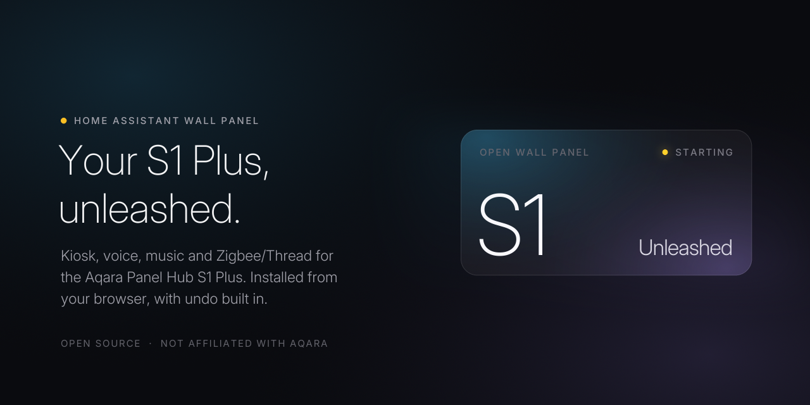
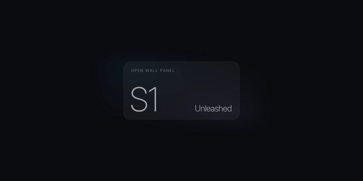
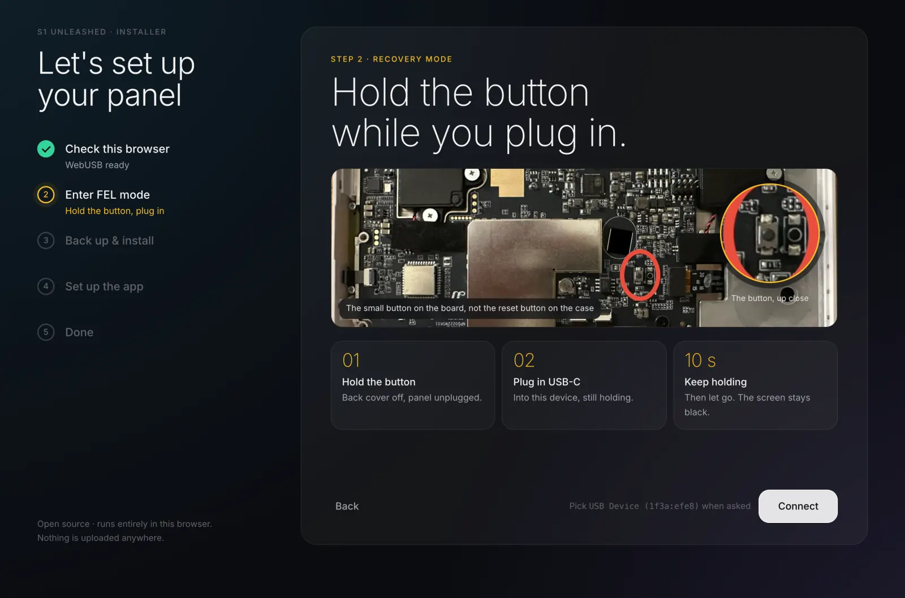
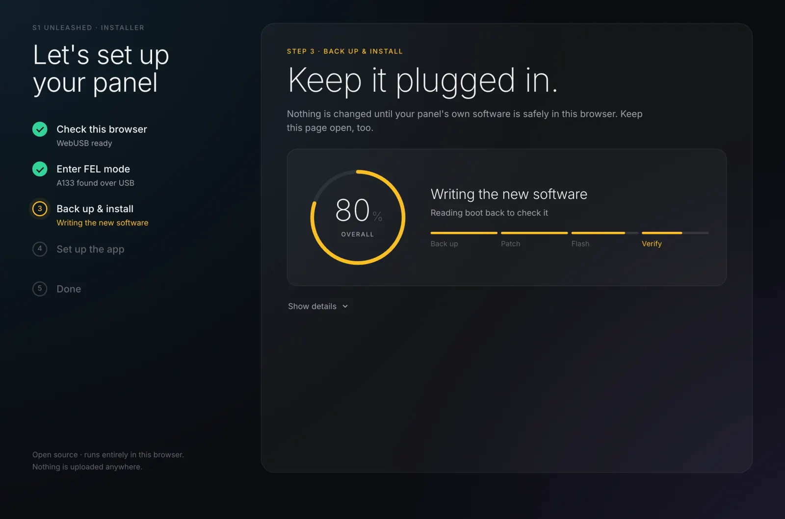
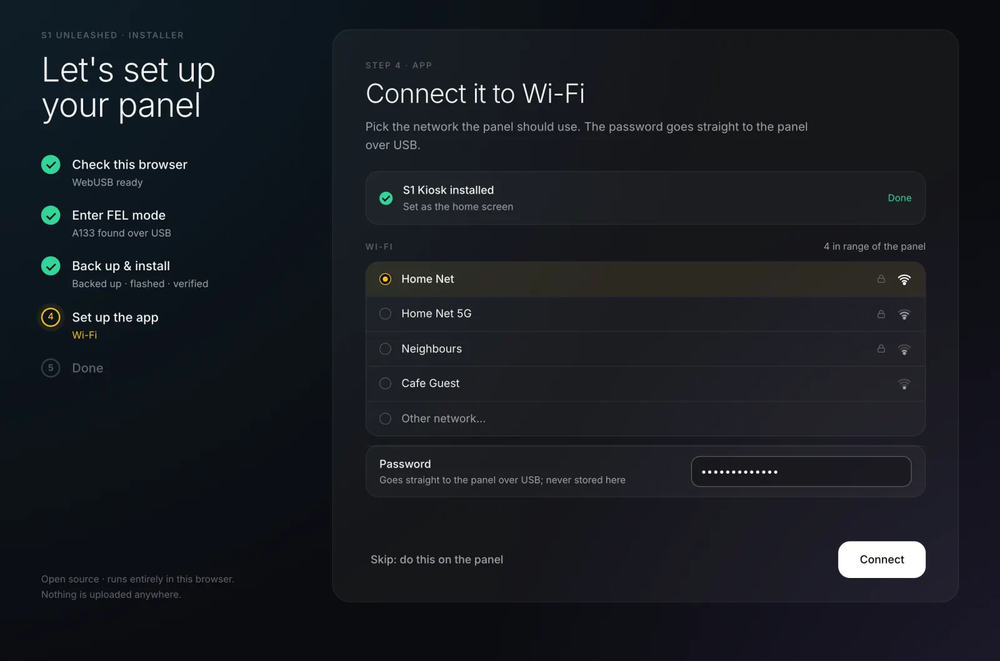
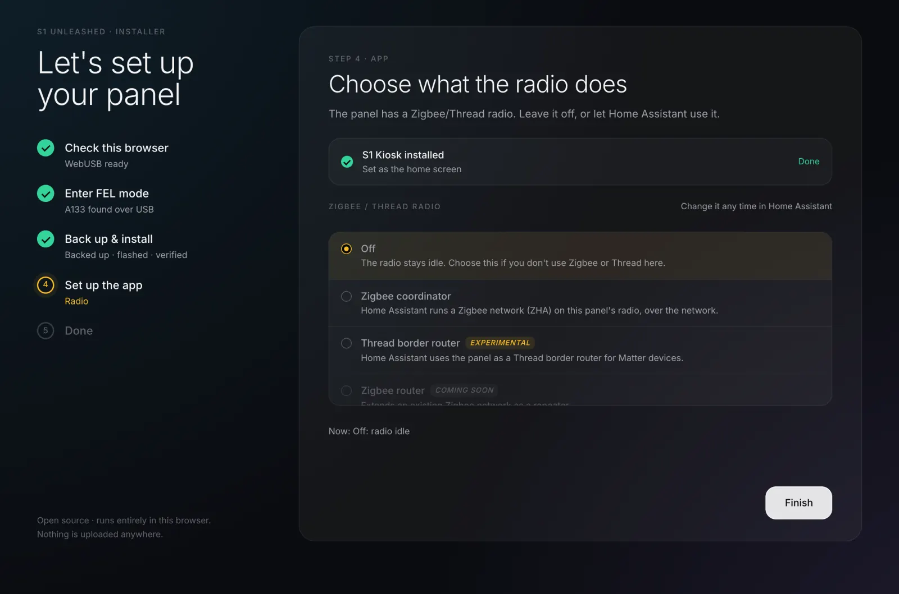

<p align="center">
  
</p>

<h1 align="center">S1 Unleashed</h1>

<p align="center">
  <b>Turn the Aqara Panel Hub S1 Plus into a Home Assistant wall panel.</b><br>
  Dashboard, voice assistant, music, presence and the built-in Zigbee/Thread radio, all local.<br>
  Installed from your browser over one USB cable, with a backup first and undo built in.
</p>

<p align="center">
  <a href="#install">Install</a> ·
  <a href="#what-you-get">Features</a> ·
  <a href="#status">Status</a> ·
  <a href="#undo-and-safety">Undo &amp; safety</a> ·
  <a href="#faq">FAQ</a> ·
  <a href="docs/research/README.md">How we got here</a>
</p>

---

## Why

The S1 Plus is good wall hardware: a 1440×720 touchscreen, a microphone and a speaker, a
time-of-flight presence sensor, an ambient light sensor, a Zigbee/Thread radio and a mains relay
base. Out of the box it only runs Aqara's launcher and talks to Aqara's cloud. Its system
WebView is Chromium 74, which is too old for the current Home Assistant frontend.

S1 Unleashed replaces the software layer and leaves the hardware alone. The panel boots into
**S1 Kiosk**, a small open-source app built on GeckoView (Firefox's engine). It shows your
dashboard and appears in Home Assistant as a single ESPHome device. You don't need an Aqara
account, soldering, or a terminal.

## What you get

**Your dashboard, full screen.** A current Home Assistant frontend in a kiosk that is the panel's
home screen. HA's header and sidebar are hidden. You sign in by scanning a QR code with your
phone, so you never type a password on the wall. You pick which dashboard it shows in HA.

**A voice assistant.** On-device wake word (openWakeWord), Assist pipelines, timers and
announcements, with a calm full-screen overlay while you talk.

| | |
|---|---|
| 🏠 **One ESPHome device** | HA discovers the panel and sets up encryption automatically. You get the screen as a light, presence, light level, a speaker, voice settings and the wall base, plus the dashboard and radio selects. [More](docs/esphome.md) |
| 🎵 **Music Assistant player** | A native Sendspin player that plays in sync with your other speakers. [More](docs/sendspin.md) |
| 👋 **Wakes when you walk up** | The screen wakes as you approach, turns off when the room is empty, and dims at night. It is driven by the panel's own sensors. [More](docs/sensors.md) |
| 📡 **Radio for Home Assistant** | The panel's EFR32 radio can serve HA as a Zigbee coordinator (ZHA) or, experimentally, as a Thread border router. You switch modes from HA. [More](docs/radio.md) |
| 🔌 **Wall base relays** | A driver for the mains relay base that speaks its UART protocol directly, with no Aqara daemon. Not yet tried on a real base. [More](docs/research/bases.md) |
| 🔒 **No Aqara cloud** | Aqara's launcher, apps, updater and cloud daemon are switched off (reversibly), so the panel stops talking to Aqara. |
| ✨ **Its own boot screen** | The Glass Tile splash and boot animation. [More](branding/glass-tile/README.md) |

<p align="center">
  
</p>

## Install

### What you need

- An **Aqara Panel Hub S1 Plus** ([supported hardware](#supported-hardware)).
- A **USB-C data cable** and a **small screwdriver** to open the back cover once.
- **Chrome or Edge** on Windows, macOS or Linux. The installer uses WebUSB, which Firefox and
  Safari don't support.
- About **10 minutes**.

### The web installer (recommended)

**[Open the installer →](https://s1.edm.sh/)**

The installer runs entirely in your browser and uploads nothing. It walks you through five steps:

1. **Check this browser.** One-time setup on Windows (a Zadig driver) or Linux (a udev rule). On
   macOS there is nothing to set up.
2. **Enter FEL mode.** With the back cover off, hold the small button on the board while you plug
   in USB-C. FEL is the chip's built-in recovery mode.
3. **Back up and install.** The installer starts its own bootloader in RAM, then backs up the
   panel's partitions to your computer. Only after that does it patch `boot` (Magisk plus the S1
   helper), flash it and read it back to verify.
4. **Set up the app.** S1 Kiosk is installed as the home screen. From the same page you set the
   panel's Wi-Fi (sent over USB), sign it in to Home Assistant, and choose the radio mode,
   language and time zone.
5. **Done.** Home Assistant finds the panel as an ESPHome device. Click **Add**.

<table>
<tr>
<td width="50%"></td>
<td width="50%"></td>
</tr>
<tr>
<td width="50%"></td>
<td width="50%"></td>
</tr>
</table>

The full walkthrough, per-OS setup and troubleshooting are in **[docs/install.md](docs/install.md)**.

> [!NOTE]
> **The web installer is new.** It has been tested end to end on a real S1 Plus (firmware 4.5.80),
> from FEL mode through the backup, the install and the app setup. The boot patch has been tested
> on two firmware versions: 4.5.80 and the December 2025
> firmware the panel shipped with. If anything looks wrong, stop and
> [open an issue](https://github.com/aguilaair/aqara-s1-unleashed/issues). Your backup is safe.

### The command line

The same steps as shell scripts, for people who would rather run them by hand (macOS or Linux;
needs `sunxi-fel`, `fastboot`, `adb`, Docker and a U-Boot build):

```sh
tools/install/fel-install.sh ~/s1-backup          # FEL → back up → patch → flash → verify
tools/install.sh --url http://homeassistant.local:8123 \
    --timezone America/Los_Angeles --locale en-US # install and configure S1 Kiosk over adb
```

See [docs/install.md](docs/install.md#command-line) for the details.

## Undo and safety

- **The backup comes first.** Nothing is written until the panel's own partitions are on your
  computer: in the browser and as a `.zip` with a `SHA256SUMS` file, which the CLI's `--undo`
  also accepts. Keep the backup from your **first** install, because it is the only copy of the
  original software.
- **Every write is verified.** The installer reads each partition back after flashing it and
  stops if anything differs. It refuses hardware it doesn't recognise (SoC id, partition layout)
  before it writes anything.
- **Small footprint.** It changes three partitions: `boot`, the `vbmeta` flags and the boot
  splash. Android, `system` and `vendor` are never modified, and everything Aqara ships is
  disabled rather than deleted.
- **Undo is built in.** In the installer, choose *Undo a previous install*. It writes your backed-up
  partitions back over FEL. Then a factory reset on the panel removes S1 Kiosk and its settings.
  From the CLI, run `tools/install/fel-install.sh --undo <backup-dir>`.
- **Hard to brick.** FEL lives in the chip's mask ROM, so it can't be erased. As long as you
  have your backup, you can always get back in.

> [!WARNING]
> This modifies a device you own, at your own risk, and probably voids its warranty. It has
> been tested on a small number of panels. Follow the steps as written.

## Supported hardware

| Device | Status |
|---|---|
| **Aqara Panel Hub S1 Plus, MP-K03D** (wall-mounted; EU, UK, AU and other regions) | ✅ Tested on firmware 4.5.80 |
| S1 Plus for China, JYMKP01LM (86-box) | ❓ Untested. The installer refuses it if the layout doesn't match. |
| S1 Plus Desktop, MP-K05D | ❓ Untested |
| Other Aqara panels and hubs | ❌ Not supported |

Inside: Allwinner A133 (quad Cortex-A53), 2 GiB DDR4, 8 GB eMMC, Android 10, a 1440×720 screen,
an EFR32 802.15.4 radio, a VI5300 time-of-flight sensor and an ambient light sensor.

## Status

| Feature | Status |
|---|---|
| Kiosk, HA dashboard, QR sign-in, dashboard picker | ✅ Works |
| ESPHome device with automatic encryption | ✅ Works |
| Voice assistant with on-device wake word, timers, announcements | ✅ Works · far-field tuning ongoing |
| Music Assistant player (Sendspin, synced) | ✅ Works |
| Presence wake, idle-off, night mode, auto-brightness | ✅ Works |
| Aqara cloud and bloat disabled (reversible) | ✅ Works |
| Glass Tile boot splash and animation | ✅ Works |
| Command-line installer and undo | ✅ Works · used on a factory-fresh panel (firmware 4.5.80) |
| **Web installer** | ✅ Tested end to end on a real panel (firmware 4.5.80); boot patch tested on two firmware versions |
| Radio: Zigbee coordinator for ZHA (over the network) | ✅ Works on the reference panel · ZHA only |
| Radio: **Thread border router** | 🧪 **Experimental** |
| Radio: **Zigbee router, Thread router** (repeaters) | 🧪 **Experimental**: both joined a real home network (ZHA, and Home Assistant's Thread network as a router) |
| Wall base relays | 🧪 Driver done and checked against Aqara's own tool, but not yet tried on a real base |
| Wi-Fi setup over Bluetooth (Improv) | 🧪 Implemented; lightly tested |

## FAQ

<details>
<summary><b>Do I need to solder or use a serial console?</b></summary>

No. You open the back cover once to press a button on the board while you plug in USB-C. A
serial console was only used during development.
</details>

<details>
<summary><b>Can I go back to stock?</b></summary>

Yes. *Undo a previous install* (or `fel-install.sh --undo`) restores `boot`, `vbmeta` and the
splash from your backup, and a factory reset afterwards brings back Aqara's setup. See
[docs/install.md](docs/install.md#undo).
</details>

<details>
<summary><b>Do I need an Aqara account or the Aqara app?</b></summary>

No. A panel that was never set up with Aqara works fine. If it was, it keeps its Wi-Fi.
</details>

<details>
<summary><b>Will my Aqara Zigbee devices keep working?</b></summary>

Not through Aqara: its hub software is switched off. The panel's radio can instead act as a
Zigbee coordinator for Home Assistant (ZHA), and you re-pair your devices there.
</details>

<details>
<summary><b>Does the panel still talk to Aqara's cloud?</b></summary>

No. The kiosk stops Aqara's cloud daemon a few seconds after boot and disables Aqara's apps and
updater. For zero internet access, also block the panel at your router; it only needs your LAN.
The panel downloads the openWakeWord models from GitHub once.
</details>

<details>
<summary><b>Will Aqara firmware updates still arrive?</b></summary>

No. Aqara's updater is disabled while S1 Unleashed is installed. Undo first if you want stock
updates back.
</details>

<details>
<summary><b>Why GeckoView and not the built-in browser?</b></summary>

The panel's system WebView is Chromium 74 and can't run the current Home Assistant frontend.
GeckoView ships its own up-to-date engine inside the app.
</details>

<details>
<summary><b>Which Home Assistant version do I need?</b></summary>

A current one: development and testing use HA 2026.11 and Music Assistant 2.10. Voice needs an
Assist pipeline; music needs Music Assistant with Sendspin.
</details>

<details>
<summary><b>How was this figured out?</b></summary>

FEL bring-up, a DRAM controller fix for mainline U-Boot, a byte-exact Magisk patch in the
browser, the radio and the wall base protocol: it's all written up in
**[How we got here](docs/research/README.md)**.
</details>

## Repository

| Path | What |
|---|---|
| [`web/`](web/src/README.md) | The browser (WebUSB) installer |
| [`app/`](app/README.md) | S1 Kiosk, the Android app (GeckoView, ESPHome API, voice, Sendspin) |
| `tools/` | Command-line installer, U-Boot/FEL build, boot patch, radio helper, dev tools |
| [`branding/`](branding/glass-tile/README.md) | Glass Tile boot splash and animation, social preview |
| [`docs/`](docs/README.md) | User guides, plus [research](docs/research/README.md) |

## Credits and licenses

Built by [@aguilaair](https://github.com/aguilaair). It stands on the work of
[linux-sunxi](https://linux-sunxi.org/) (sunxi-tools, U-Boot), [Magisk](https://github.com/topjohnwu/Magisk),
[Home Assistant](https://www.home-assistant.io/), [ESPHome](https://esphome.io/),
[Music Assistant](https://music-assistant.io/), [OpenThread](https://openthread.io/),
[openWakeWord](https://github.com/dscripka/openWakeWord) and
[Tango / ya-webadb](https://github.com/yume-chan/ya-webadb).

S1 Unleashed's own code is **MIT** ([LICENSE](LICENSE)). Third-party parts keep their licenses:

| Component | License | How it's used |
|---|---|---|
| U-Boot (with our A133 patches) | GPL-2.0-or-later | Built from source in [`tools/fel/`](tools/fel); runs from RAM only |
| Magisk v31.1 | GPL-3.0 | The official release APK, pinned by SHA-256 (the CLI downloads it, the web installer serves the same file); [source](https://github.com/topjohnwu/Magisk/tree/v31.1) |
| ot-br-posix (`otbr-agent`, `ot-ctl`) | BSD-3-Clause | Built by [`tools/radio/`](tools/radio) |
| cJSON, cpp-httplib (in the border-router `otbr-agent`) | MIT | Bundled by ot-br-posix's REST server |
| Simple Keyboard | Apache-2.0 | Optional on-screen keyboard |
| GeckoView | MPL-2.0 | Maven dependency of S1 Kiosk |
| TensorFlow Lite, Media3 ExoPlayer, ZXing | Apache-2.0 | Wake word inference, audio, QR codes |
| Bouncy Castle | MIT-style | ESPHome API encryption |
| Tango (ya-webadb) | MIT | adb over WebUSB in the installer |
| Inter | SIL OFL 1.1 | Boot branding, fetched at build time |
| openWakeWord models | **CC BY-NC-SA 4.0** | **Not shipped.** The panel downloads them itself. Non-commercial. |

**Not affiliated with Aqara or Lumi United.** Aqara and the product names are trademarks of their
owners and are used here only to say which device this works with. No Aqara software is
included in this repository.
