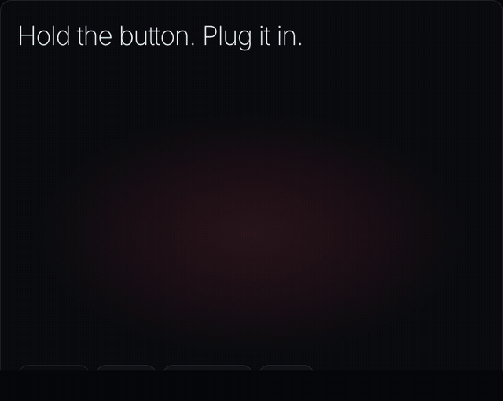

# Kiln: design prototypes

Design work for Kiln, the Glassworks installer (#32). Nothing here is part of the shipped installer
in `web/`. It's the reference for building Kiln's UI, and for the per-frame recovery animation.

| File | What |
|---|---|
| [sketch.html](sketch.html) | The Kiln screens: panel, connect, your turn, install, Wi-Fi, Home Assistant, done, undo, error |
| [recovery/player.js](recovery/player.js) | The recovery-mode player: draws any frame's device and animates its steps from data |
| [recovery/aqara-s1-plus.json](recovery/aqara-s1-plus.json) | The S1 Plus's recovery data |
| [recovery/index.html](recovery/index.html) | Preview: plays `?frame=<id>` from `<id>.json` in that folder |
| `img/` | The screens and the recovery loop, rendered for the issue |

To view them, serve this folder (the pages load their JSON with `fetch`):

```sh
cd docs/design/kiln && python3 -m http.server 8765
# http://localhost:8765/sketch.html
# http://localhost:8765/recovery/index.html?frame=aqara-s1-plus
```



## Principles

- **One idea per screen.** A short heading, at most one line under it, one ember button.
- **Details on request.** The browser check is a chip in the header and only becomes a screen when
  it fails. Partitions, hashes and the raw log sit behind "Technical log". Driver setup appears only
  on Windows and Linux.
- **The stack is the progress.** The rail's stack sets layer by layer from Kiln's ember floor as
  the install goes; a failure shows the layer dashed in rose.
- **Plain log.** A few ✓ lines in plain words ("Backed up and checked"), not partition names.
- **Errors** say what happened, whether anything was written, and the one most likely fix.

Kept from the current installer, in this lighter form: "your turn" when the browser needs a click
(now a sheet over the step), progress that never goes backwards, the backup download on Done, undo
with its two depths, and "skip, do this on the panel" during setup. Worth adding in Kiln: a
leave-page warning during writes, a screen wake lock, and live-region announcements.

## The recovery section

Each frame describes the physical steps into recovery mode as data, in millimetres, in the
panel's own coordinates (lying face down, the long edge at `y = 0` furthest away). The player
draws the device at the brand's 30° angle and animates the steps. Adding a frame means measuring
it, not drawing an animation. This section moves into the generated `frame.json` once #35 lands.

| Field | Meaning |
|---|---|
| `body` | `w`, `h`, `thickness`, `radius` in mm |
| `cover.screws` | Screw centres, `[x, y]` mm, in the order they come out |
| `cover.features` | What the back looks like: `ribs`, `plate`, `hole`, `clip` rectangles (`at`, `size`) |
| `board` | What's under the cover: `speaker`, `shield`, `chip` rectangles, `window` circles |
| `button` | The button to hold: `at` in mm, and `what` (a sentence for the photo's caption) |
| `port` | `edge` (`top`, `bottom`, `left`, `right`), `at` (mm along that edge), `kind` |
| `steps` | Moves, in order: `screws`, `cover`, `hold`, `plug` |
| `ready` | `seconds` until recovery mode, and what the label `says` |
| `photo` | A real photo behind "Show me a photo" |

Between moves the player adds its own transitions: a faint pass of light over the board once the
cover is off, a spotlight that closes on the button, then opens to the port while a guide line
shows where the cable goes. The plug slides in square to its edge; if that face is out of view, the
panel hides the part that goes in. With reduced motion it shows one still frame.

Moves still to add when a frame needs them: `clip` (pry the case open), `press` (a button
combination on the case) and `wait`.

## S1 Plus

Measured from photos of the back and of the board. Nine silver screws hold the back. The button is
right of the shield's notch, below the round sensor window. With the button held, the panel enters
recovery mode as soon as USB-C goes in, within about two seconds.
