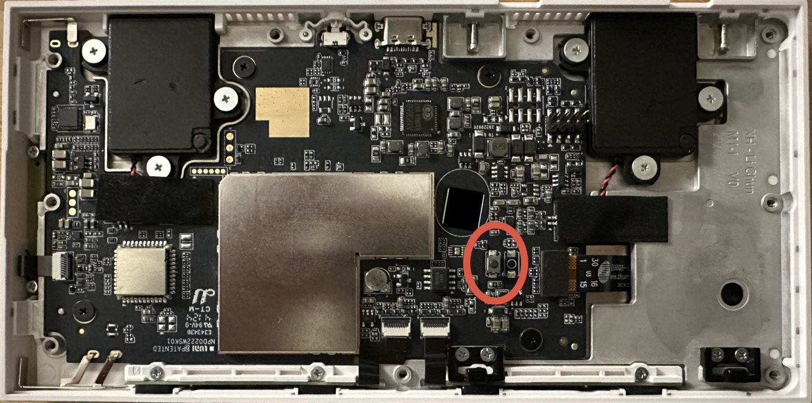

# Hardware

## SoC / board

- **Allwinner A133** (`sun50iw10`), SoC id `0x1855`. Marketed interchangeably as **R818**. USB descriptor in FEL reports board name `QUAD-CORE R818 EVB2`, VID `0x1F3A`.
- 2 GiB DDR4, ~8 GB eMMC (MMC 5.1), PMIC **AXP806**.
- Android board/product: `peony_evb2` / `peony-perf1`, `android.hardware = sun50iw10p1`.

## Thermal zones and what an app can read

**Verified 2026-11-12** with read-only adb (shell user) on the reference panel, S1 Kiosk 0.4.3,
kernel 4.9.170. The diagnostics pane uses these (#123).

| Path | Read |
|---|---|
| `/sys/class/thermal/thermal_zone0` | `type` = `cpu_thermal_zone`, `temp` = 47999 (m°C), mode enabled |
| `/sys/class/thermal/thermal_zone1` | `gpu_thermal_zone`, 47463 |
| `/sys/class/thermal/thermal_zone2` | `ddr_thermal_zone`, 47463 |
| a zone's `temp` | `-r--r--r-- root root`, `u:object_r:sysfs_thermal:s0` |
| `/proc/stat` | `-r--r--r--`, `u:object_r:proc_stat:s0`; SELinux is permissive, so the app can read it |
| `/proc/<pid>/smaps_rollup` | present (backported to 4.9); the shell user gets *Permission denied* for the app's pids |

Every app process, Gecko's included, runs as the app's uid (`ps -A`): the main process, and
`:crashhelper_…`, `:gpu_…` and `:sandboxed_tab_…<n>` from GeckoView. The main process's `comm` is
`AndroidUI`, not the package name.

## FEL button

There is **one unlabeled tactile button on the PCB** (you must open the back cover to reach it). Hold it while applying USB-C power to enter FEL. The **external** case button and the Aqara pairing button do not enter FEL.



*The FEL button (circled): a small tactile switch right of the shield can's notch, just below the round sensor window.*

## Debug UART console (3-pin header)

A 3-pin header exposes the serial console. The pads are **flat (castellated/holes)**, so a firm or soldered connection is needed.

| Signal | Notes |
|---|---|
| GND | Find with a multimeter (continuity to USB-C shield / ground plane) |
| TX  | Panel transmit — idles 3.3 V, streams boot log. Connect to your adapter's RX |
| RX  | Panel receive — connect to your adapter's TX to type |

- **Level: 3.3 V TTL.** Do **not** use a 5 V adapter.
- **Settings: 115200 baud, 8N1.**
- There is also a separate **6-pin (2×3) connector** — that one goes to the **relay module**, not the console. Ignore it.

The console gives a live **root-capable Android shell** (`console:/ $`), and catches U-Boot's `Hit any key to stop autoboot`.

## Using an ESP32-S3 as the UART adapter (dev only)

End users won't need UART, but for development any ESP32-S3 works as a 3.3 V USB↔UART bridge — see [`tools/esp32-uart-bridge`](../../tools/esp32-uart-bridge). It bridges the S3's native USB-Serial/JTAG (or a CP2102) to a hardware UART on two free GPIOs (default **GPIO40 = TX → panel RX**, **GPIO41 = RX → panel TX**), locked at 115200.

Wiring:

```
ESP32-S3 GND     -> panel GND
ESP32-S3 GPIO40  -> panel RX
ESP32-S3 GPIO41  -> panel TX
```

Verify the adapter before touching the panel by jumpering its TX↔RX and confirming a loopback echo.
